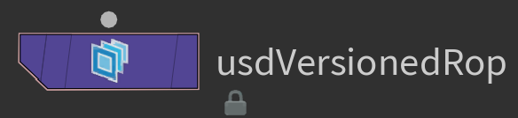
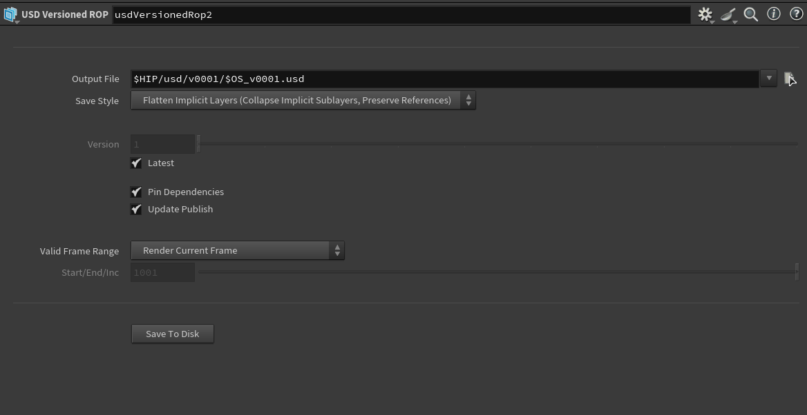
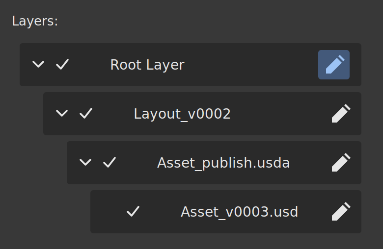
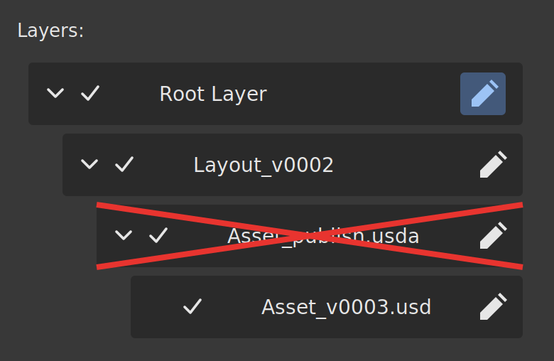
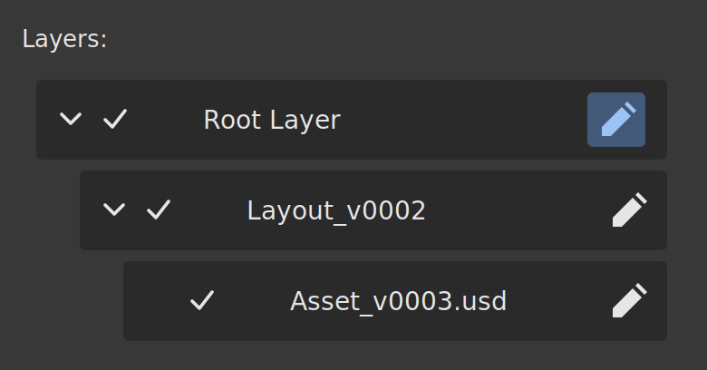

# USD Versioned Export

A Houdini HDA that exports a LOP stage to a **versioned USD file**, optionally updates a **publish file** that points to the chosen version, and writes a **JSON file** recording who exported what, when, and from which scene.

It can also **pin dependencies**: references to other assets/layer **publish** files are replaced with the exact versions they currently point to, so an old export keeps loading the same data even after those assets are republished.



## Features
- Automatic version numbering (`v0001`, `v0002`, ...) or a manually chosen version.
- A publish file (`<name>_publish.usda`) that sublayers the latest version and keeps the stage metadata (up axis, units, time codes, default prim).
- Dependency pinning: publish references are swapped for the versioned files behind them.
- A JSON file next to each versioned export with the user, date, source scene, version, options used and pinned dependencies.
- Works in the UI and without one (batch or farm).

## Installation
1. Download `usd_versioned_export.hda` from the [`hda/`](hda/) folder.
2. Copy it to your Houdini `otls` folder.
3. In a LOP network, press `Tab` and search for **USD Versioned Export**.

## Usage
1. Connect the node below the stage you want to export.
2. Set the **Output File** (the base path and name of the export).
3. Choose your options (see the table below).
4. Click **Save To Disk**.



## Parameters

| Parameter | Description |
|-----------|-------------|
| **Output File** | Base USD file path. The export is written to a `vXXXX` folder next to this file's parent folder, named `<name>_vXXXX.usd`. |
| **Save Style** | How layers are written to disk. "Flatten Implicit Layers" merges implicit sublayers into the exported file and keeps references to other files intact. |
| **Version** | Version number to export. Only used when **Latest** is off. If that version already exists, its files are overwritten. |
| **Latest** | Exports to the next free version number (highest existing version + 1) and fills in the Version field. |
| **Update Publish** | After exporting, updates `<name>_publish.usda` so it points to this new version. Any scene or asset referencing the publish picks up this version. Turn off to export a version without changing what those references see. |
| **Pin Dependencies** | Replaces references to other assets' publish files with the exact versions they currently point to. See [Pin Dependencies](#pin-dependencies). |
| **Valid Frame Range** | Which frames are exported: the current frame, a range, or the playbar range. |
| **Start/End/Inc** | First frame, last frame and step of the exported range. Only used with a custom frame range. |
| **Save To Disk** | Runs the export with the options above. |

## Output structure

```
usd/
├── asset_publish.usda        # points to the latest published version
├── v0001/
│   ├── asset_v0001.usd
│   └── asset_v0001.json
├── v0002/
│   ├── asset_v0002.usd
│   └── asset_v0002.json
└── ...
```

The publish file only contains one sublayer pointing to a version, plus the stage metadata. Updating the publish means changing that single pointer.

 TBA

## Pin Dependencies

### The problem
When an asset references another asset through its **publish** file, the reference always follows whatever that publish currently points to. If the child asset is republished, every older export silently changes too, and it becomes impossible to reproduce an earlier state.

### The solution
With **Pin Dependencies** on, the exported version no longer references the child's publish file. It references the **versioned file the publish was pointing to at the time of export**. The child can be republished freely, and this version keeps loading the same data.

### Before / after

| Before pinning | During pinning | After pinning |
|----------------|----------------|---------------|
| *The export references `asset.usda`* | *The export removes the reference to the publish version `asset.usda -> asset_v0003`*   | *The export references `asset_v0003.usda`* |
|  |  |  |

The same change seen in the USD file :

```usda
# Before
references = @../asset/asset_publish.usda@

# After
references = @../asset/v0004/asset_v0004.usd@
```

### What gets pinned
- Only references to files ending in `_publish.usda` are pinned.
- Only references inside the **exported file** and not lower publish.
- Other references (textures, caches, files outside the publish convention) are left untouched.
- Paths stay relative, like in the original reference.

## JSON metadata

Each export writes a `.json` file next to the USD file:

```json
{
    "user": "username",
    "date": "2026-11-10T14:32:05",
    "hip_file": "D:/project/scene.hip",
    "file": "asset_v0001.usd",
    "version": "v0001",
    "published": true,
    "pinDependencies": true,
    "pinnedDependencies": [
        {
            "from": "../chair/chair_publish.usda",
            "to": "../chair/v0004/chair_v0004.usda"
        }
    ]
}
```

`pinnedDependencies` only appears when something was actually pinned. The file can be used to trace a version back to its source scene, build a publish history, or display information in a tool.

## Project structure

```
usd_versioned_export/
├── README.md
├── usd_versioned_export.hda
├── python/
│   └── export_usd_versioned.py   # readable copy of the HDA's Python code
└── screenshots/
```

## Notes
- The publish convention is hard-coded: publish files must end in `_publish.usda`.
- With **Latest** off, exporting to an existing version overwrites it.
- Tested on: Houdini 21, Windows.

## Author
Arthur Cauchois - [LinkedIn](https://www.linkedin.com/in/arthur-cauchois-56674b237/)
